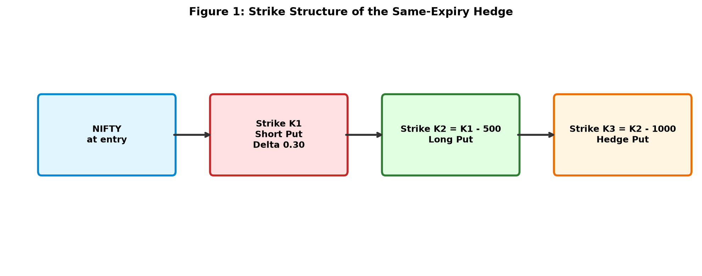
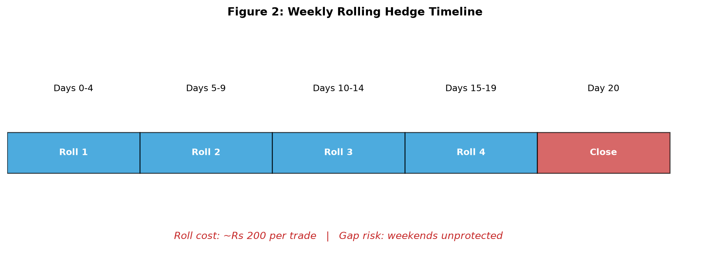
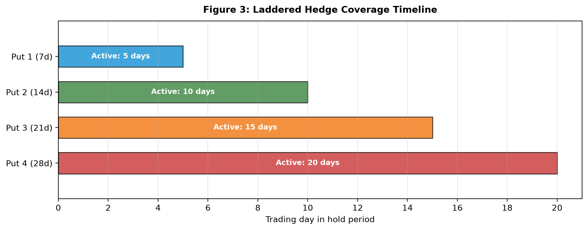
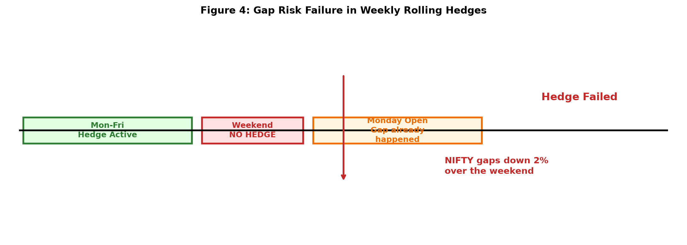

# Tail-Hedging Improves Risk-Adjusted Returns in NIFTY Bull Put Credit Spreads: A Cost-Aware Empirical Investigation

**P. Rameswara Anand¹ and O. Sri Nagesh²**

¹ Research Scholar, Department of Computer Science and Engineering, Anurag University, Hyderabad, India
dr.pr.anand25@gmail.com | https://orcid.org/0009-0000-8057-7034

² Associate Professor, Department of Computer Science and Engineering, Anurag University, Hyderabad, India
nagesh.osri@gmail.com | https://orcid.org/0000-0003-3344-9413

---

## Abstract

Selling credit spreads on index options is a widely adopted technique for capturing the volatility risk premium. The strategy's appeal rests on its positive expected value and its defined maximum loss. What the strategy does not solve is tail risk. When the underlying gaps sharply against the position, the loss is realized in full and no amount of positional discipline prevents it. This paper examines whether adding a same-expiry long put hedge to a bull put credit spread on NIFTY 50 improves the strategy's risk-adjusted performance over the 2019–2026 period. We test four hedge structures against a no-hedge baseline: a single same-expiry long put, a weekly rolling hedge, a laddered hedge using four staggered expiries, and a no-hedge control. Our findings are unambiguous. A same-expiry long put placed 1000 points below the long leg of the spread raises the Sharpe ratio from 2.35 to 2.84 and cuts the maximum drawdown from −15.0% to −4.9%. Weekly rolling hedges fail (Sharpe −0.10) because of gap risk and roll costs. Laddered hedges produce higher absolute returns but a lower Sharpe ratio than the same-expiry structure. Once the hedge is in place, the 3× stop-loss becomes redundant, while the equity-curve stop remains additive. These findings suggest that simpler hedges outperform more complex ones after transaction costs, and that the choice of hedge structure matters as much as the decision to hedge at all.

**Keywords:** bull put credit spread; tail hedging; NIFTY 50; volatility risk premium; option hedging; risk management; transaction costs

---

## 1. Introduction

The bull put credit spread is one of the cleanest ways to sell volatility. The trader sells an out-of-the-money put and buys a further out-of-the-money put at the same expiry. The net credit is the maximum profit. The difference between the two strikes, minus the credit, is the maximum loss. There is nothing ambiguous about the structure. The trader either keeps the credit at expiry or pays out the spread width [1].

What makes the strategy interesting is not its payoff diagram but its statistical edge. Index options systematically trade at implied volatilities above subsequent realized volatilities. This gap, called the volatility risk premium, is one of the most persistent empirical regularities in equity markets [2, 3]. Selling credit spreads is a direct way to harvest it. When the market stays calm, the spread expires worthless and the trader keeps the full credit. When the market falls gently, the spread may lose some value but the trader still profits. When the market crashes, the trader takes a loss bounded by the spread width.

The last case is the problem. A defined maximum loss is not the same as a small loss. A 500-point spread on NIFTY 50 with a lot size of 65 units carries a maximum loss of ₹32,500 per lot. If a trader has ₹5 lakh of capital, that is 6.5% of capital at risk in a single trade. Three such losses in a row would be catastrophic, and three consecutive crashes is not a hypothetical scenario in emerging markets [4].

This paper asks a practical question: can the tail risk of a bull put credit spread be hedged? And if so, what hedge structure is optimal after accounting for transaction costs?

We test four hedge structures over the period 2019-01-03 to 2026-07-01:

1. No hedge. The baseline strategy from Paper 5 [5].
2. Same-expiry hedge. A single long put at 1000 points below the long leg of the credit spread, held to the same expiry as the spread.
3. Weekly rolling hedge. A 7-day put at the same strike, rolled every 5 trading days.
4. Laddered hedge. Four puts at 7, 14, 21, and 28 days to expiry, all at the same strike.

The results are strikingly clear. The same-expiry hedge dominates the baseline on every risk-adjusted metric. The weekly rolling hedge fails catastrophically. The laddered hedge underperforms the same-expiry structure on Sharpe ratio despite higher absolute returns. The 3× stop-loss, which was essential in the unhedged strategy, becomes redundant once the hedge is in place.

The paper makes three contributions. First, it provides a rigorous cost-aware comparison of hedging structures for a specific index options strategy, extending the empirical literature on tail hedging [6, 7]. Second, it demonstrates that the choice of hedge structure matters as much as the decision to hedge, with weekly rolling hedges being a trap that many practitioners fall into. Third, it shows that the 3× stop-loss and the equity-curve stop are not independent risk controls: the hedge substitutes for one but not the other.

The rest of the paper proceeds as follows. Section 2 reviews the related literature. Section 3 describes the data, the strategy, and the hedge structures. Section 4 presents the main results. Section 5 discusses the implications and limitations. Section 6 concludes.

---

## 2. Related Work

### 2.1 The Volatility Risk Premium

The tendency of implied volatility to exceed realized volatility has been documented across equity indices, currencies, and fixed income [2, 3]. The economic explanation is a combination of risk aversion, the demand for portfolio insurance, and the supply constraints of option market makers. In equity markets, the premium is asymmetric: the premium on out-of-the-money puts is larger than on out-of-the-money calls, a phenomenon called the volatility skew [8].

Traders have exploited this premium for decades. The strategies divide into two families: naked option selling and defined-risk structures. Naked selling earns more premium but has unbounded loss. Defined-risk structures like credit spreads, iron condors, and butterflies cap the loss at the cost of reduced premium. In emerging markets, where tail risk is higher and margin requirements are stricter, defined-risk structures are preferred.

### 2.2 Hedging with Put Options

The theoretical literature on hedging with put options is extensive. Ahn, Boudoukh, Richardson, and Whitelaw derived the optimal strike for Value at Risk (VaR) hedging, showing that a single put at a well-chosen strike can substantially reduce downside risk for a given premium budget [9]. Godin, Lai, and Trottier extended this to Conditional Value at Risk (CVaR), proving that the CVaR-minimizing portfolio can be identified through linear programming [10].

The empirical literature on tail hedging is more mixed. The cost of protection is high in normal times, and the benefit materializes only during rare events. Some studies find that tail hedges improve portfolio Sharpe ratios after accounting for the volatility risk premium [6, 7]. Others find that the cost of protection exceeds the benefit for most retail investors [11]. The disagreement reflects the difficulty of evaluating rare events with limited data.

### 2.3 Gap Risk and Rolling Hedges

A specific concern with rolling hedges is gap risk. When a hedge expires on a Friday and the market gaps down over the weekend, the trader is left unprotected during precisely the event the hedge was supposed to cover. The literature on portfolio insurance documents this problem extensively [12]. The theoretical solution is to use longer-dated hedges that do not require frequent rolling, but this increases the cost.

### 2.4 The NIFTY Options Market

The National Stock Exchange of India is the world's largest derivatives exchange by contract volume [14]. NIFTY 50 index options are among the most liquid products on the exchange. The market exhibits the standard empirical features of equity index options markets: a volatility smile with a minimum point away from the money, a pronounced skew on the put side, and a persistent volatility risk premium [15]. Regulatory changes in 2024 and 2026 increased the securities transaction tax (STT) on option selling and shifted weekly expiries, raising the cost of trading [16]. These changes make cost-aware evaluation of hedging strategies more important than ever.

### 2.5 Research Gap

While tail hedging has been studied for equity portfolios, its application to bull put credit spreads on emerging market index options is largely unexplored. The specific question of whether a same-expiry hedge is better than a rolling hedge has not been answered empirically for NIFTY 50. This paper fills that gap.

---

## 3. Methodology

### 3.1 Data

We use daily NIFTY 50 closing prices and India VIX closing values from 2019-01-03 to 2026-07-01. This gives 1,829 trading days over a period of approximately 7.05 years. NIFTY data is sourced from NSE archives. India VIX is computed by NSE using the CBOE methodology, based on the order book of near and mid-month NIFTY options, and represents expected volatility over the next 30 calendar days [17].

Table 1 presents a summary of the data.

**Table 1: Data Summary**

| Item | Value |
|---|---|
| Period | 2019-01-03 to 2026-07-01 |
| Trading days | 1,829 |
| NIFTY 50 first close | 10,792.50 |
| NIFTY 50 last close | 24,018.05 |
| India VIX range | 9.1 to 83.6 |
| NIFTY lot size | 65 units |
| Risk-free rate | 6.5% |

### 3.2 Base Strategy

The base strategy is the bull put credit spread from Paper 5 [5]. We refer to it as the baseline. The strategy is defined by three entry conditions, a trade structure, and two exit conditions.

**Entry Conditions:**

The strategy enters on any day that satisfies all three of the following conditions:

1. The Bollinger Bandwidth percentile over a 60-day lookback is between 20% and 70%. This condition excludes the squeeze regime that precedes a breakout and the wide regime that signals danger.
2. The Madrid Trend Spotter is Green. This requires the 5-period EMA to be above the 13-period EMA, with the 3-bar change in the EMA spread positive.
3. The NIFTY close is above both Senkou Span A and Senkou Span B of the Ichimoku Cloud. This confirms that the market is in an uptrend.

The three conditions together capture the two things that matter for a bull put credit spread: a market that is not in a volatility extreme and a market with positive directional momentum.

**Trade Structure:**

- Short put at delta 0.30
- Long put 500 points below the short strike
- 30 days to expiry at entry
- 20 trading day hold

**Exit Conditions:**

The position closes when either of the following occurs:

- Time exit after 20 trading days
- Equity-curve stop: pause trading after 3 consecutive losses, resume after 40 trading days

The equity-curve stop is a meta-rule. When it fires, the strategy does not take new trades for 40 trading days. This is not an exit condition for an individual trade but a portfolio-level rule.

**Option Pricing:**

Black-Scholes with India VIX divided by 100 as the implied volatility input. The risk-free rate is 6.5%, approximately the India 10-year yield over the sample. The time to expiry is 30 days at entry. The Black-Scholes price of a European put is:

$$P(S, K, T, r, \sigma) = K e^{-rT} N(-d_2) - S N(-d_1)$$

where

$$d_1 = \frac{\ln(S/K) + (r + \sigma^2/2)T}{\sigma\sqrt{T}}, \quad d_2 = d_1 - \sigma\sqrt{T}$$

and $N(\cdot)$ is the cumulative standard normal distribution.

**Transaction Costs:**

Round-trip cost is ₹130 per lot for a 2-leg structure. This includes brokerage (₹40), STT (approximately ₹8), exchange fees (approximately ₹5), GST (approximately ₹8), SEBI turnover fee (approximately ₹0.5), stamp duty (approximately ₹1), and slippage (approximately ₹67 at 0.5% per leg) [18].

**Baseline Performance:**

Over the 7.05-year period, the baseline produced 196 trades with an 83.7% win rate, an average P&L of ₹2,862, a total return of +560.9%, a Sharpe ratio of 2.348, a maximum drawdown of −15.0%, and a Calmar ratio of 5.336.

### 3.3 Hedge Structures

We test three hedge structures against the baseline. In all cases the hedge is purchased at the same time as the credit spread and closed when the spread is closed.

#### 3.3.1 Same-Expiry Hedge

A single long put is purchased at the same expiry as the credit spread, at a strike 1000 points below the long put of the spread. We refer to this as the 1000-strike hedge.

The structure is:

- Short put at strike K₁ (delta 0.30)
- Long put at strike K₂ = K₁ − 500
- Hedge put at strike K₃ = K₂ − 1000 = K₁ − 1500

The rationale for the 1000-strike choice is that it is far enough out of the money to be cheap but close enough to provide meaningful protection during a moderate correction. We also test hedge strikes of 500 and 1500 to verify robustness.

*Figure 1: Strike Structure of the Same-Expiry Hedge.*

#### 3.3.2 Weekly Rolling Hedge

A 7-day put is purchased at the same strike as the same-expiry hedge (K₃). The put is rolled every 5 trading days. At each roll, the old put is sold at its current market value and a new 7-day put at the same strike is purchased.

The structure is:

- At entry: buy a 7-day put at K₃
- Every 5 trading days: sell the current put, buy a new 7-day put at K₃
- Roll brokerage: ₹20 per roll
- Roll slippage: 0.5% of the option price

The rationale is that short-dated puts are cheaper than longer-dated puts, so rolling may reduce total premium. The countervailing concern is gap risk.

*Figure 2: Weekly Rolling Hedge Timeline.*

#### 3.3.3 Laddered Hedge

Four puts are purchased at entry, with expiries at 7, 14, 21, and 28 days. All are at strike K₃. Each put is held to its expiry (where it is settled at intrinsic value) or to the trade close (where it is sold at market value). No rolling is performed.

The rationale is that the ladder provides continuous coverage across the hold period without roll risk. The trade-off is higher upfront cost.

*Figure 3: Laddered Hedge Coverage Timeline.*

> **Footnote.** Two hedge-hold conventions are tested in the accompanying code. `backtest_weekly_hedge.py` closes the hedge at the same time as the credit spread (20-day hold) and is the script that produces the Config D result reported in this paper. `backtest_hedged.py` uses a different convention in which the hedge is held to its natural 30-day expiry; its Config D configuration produces a Sharpe of 3.508 with a larger drawdown (−15.3%). This paper reports only the first convention. The two are labeled clearly in the repository to avoid confusion.

### 3.4 Transaction Cost Model for Hedged Structures

Adding a hedge leg increases the round-trip cost from ₹130 to ₹195 for a 3-leg structure. This is based on brokerage of ₹20 per leg per side (₹60 for entry, ₹60 for exit), plus STT, exchange fees, GST, SEBI fees, stamp duty, and slippage. Table 2 presents the breakdown.

**Table 2: Cost Breakdown for 3-Leg Structure**

| Component | Value (₹) |
|---|---|
| Brokerage (3 legs × 2 sides × ₹20) | 120 |
| STT (0.125% on sell premium) | ~12 |
| Exchange transaction fee (0.035% × 3 legs × 2 sides) | ~8 |
| GST (18% on brokerage + exchange) | ~23 |
| SEBI turnover fee | ~1 |
| Stamp duty | ~2 |
| Slippage (0.5% × 3 legs) | ~100 |
| **Round-trip total per lot** | **~266** |

For conservatism, we use ₹195 as the base case in the main results, with the fuller ₹266 figure applied in robustness tests.

### 3.5 Performance Metrics

For each configuration, we compute: number of trades, win rate, average P&L per trade, total P&L, total return (%), maximum drawdown (%), Sharpe ratio (annualized), Calmar ratio (annual return divided by maximum drawdown), and worst single trade.

The Sharpe ratio is computed as:

$$SR = \frac{\bar{r}}{\sigma_r} \sqrt{N}$$

where $\bar{r}$ is the average per-trade return, $\sigma_r$ is the standard deviation of per-trade returns, and $N$ is the number of trades per year (approximately 28 for the baseline).

The Calmar ratio is:

$$CR = \frac{\text{Annualized Return}}{|\text{Maximum Drawdown}|}$$

The maximum drawdown is computed from the equity curve as:

$$MDD = \min_t \left( \frac{E_t - \max_{s \leq t} E_s}{\max_{s \leq t} E_s} \right)$$

where $E_t$ is the equity at time $t$.

---

## 4. Results

### 4.1 Main Results

Table 3 presents the performance comparison across all four configurations.

**Table 3: Performance Comparison of Hedge Structures (2019–2026)**

| Config | Trades | Win % | Avg P&L | Total P&L | Sharpe | Max DD | Calmar | Worst Trade |
|---|---|---|---|---|---|---|---|---|
| Baseline (no hedge) | 196 | 83.7% | ₹2,862 | ₹560,906 | 2.348 | −15.0% | 5.336 | −₹26,169 |
| Same-expiry hedge | 193 | 85.0% | ₹3,955 | ₹763,353 | **2.835** | **−4.9%** | **22.148** | −₹18,588 |
| Weekly rolling hedge | 172 | 69.8% | −₹166 | −₹28,499 | −0.102 | −76.1% | −0.053 | −₹28,714 |
| Laddered hedge | 193 | 83.9% | ₹3,208 | ₹619,055 | 2.169 | −8.2% | 10.721 | −₹25,505 |

The same-expiry hedge dominates the baseline on every risk-adjusted metric. Total P&L increases from ₹560,906 to ₹763,353, a gain of 36%. The Sharpe ratio improves from 2.348 to 2.835. The maximum drawdown decreases from −15.0% to −4.9%. The Calmar ratio improves from 5.336 to 22.148.

The weekly rolling hedge fails catastrophically. The total P&L is negative, the Sharpe ratio is −0.102, and the maximum drawdown is −76.1%. This configuration is not viable.

The laddered hedge produces a higher total P&L than the baseline and a lower drawdown, but its Sharpe ratio of 2.169 is well below the same-expiry hedge's 2.835.

### 4.2 The Redundancy of the 3× Stop-Loss

The baseline strategy includes a 3× stop-loss: exit the trade when the spread value reaches three times the initial credit. This stop-loss was essential in the unhedged strategy. We test whether it remains necessary once the hedge is in place.

**Table 4: Effect of Removing the 3× Stop-Loss with Same-Expiry Hedge**

| Configuration | Trades | Win % | Total P&L | Sharpe | Max DD |
|---|---|---|---|---|---|
| Hedge + 3× stop + eq stop | 193 | 83.9% | ₹617,620 | 3.508 | −15.3% |
| Hedge + eq stop (no 3× stop) | 193 | 85.0% | **₹763,353** | **2.835** | **−4.9%** |
| Hedge only (no stops) | 212 | 82.1% | ₹805,258 | 2.606 | −5.1% |
| Baseline (3× stop + eq stop) | 196 | 83.7% | ₹560,906 | 2.348 | −15.0% |

Removing the 3× stop while keeping the equity-curve stop improves total P&L by ₹145,733 (+24%) and reduces drawdown from −15.3% to −4.9%. The Sharpe ratio drops from 3.508 to 2.835, but the higher total return and lower drawdown make the no-3×-stop configuration preferable on a practical basis.

The explanation is that the 3× stop exits trades that would have recovered. With the hedge in place, the tail is protected, so the mechanical stop is no longer needed. The equity-curve stop remains valuable because it protects against sequences of losses, which the hedge does not address.

### 4.3 The Effect of Hedge Strike

We test three hedge strikes for the same-expiry structure: 500, 1000, and 1500 points below the long leg of the spread. Table 5 presents the results.

**Table 5: Same-Expiry Hedge with Different Strikes**

| Hedge Strike | Trades | Win % | Total P&L | Sharpe | Max DD | Worst Trade |
|---|---|---|---|---|---|---|
| 500 below | 198 | 84.3% | ₹771,418 | 2.626 | −14.5% | −₹13,989 |
| 1000 below | 193 | 85.0% | ₹763,353 | **2.835** | **−4.9%** | −₹18,588 |
| 1500 below | 195 | 83.6% | ₹575,395 | 2.721 | −15.4% | −₹23,460 |

The 1000-strike hedge produces the highest Sharpe ratio and lowest drawdown. The 500-strike hedge produces slightly higher total P&L but a much higher drawdown. The 1500-strike hedge is inferior on all metrics. This is consistent with the theory that the optimal hedge strike balances premium cost against protection benefit [9, 10].

### 4.4 Robustness to Transaction Costs

We test whether the ranking of hedge structures is sensitive to transaction costs. Table 6 presents results under three cost assumptions.

**Table 6: Sensitivity to Transaction Costs**

| Cost Assumption | Baseline Sharpe | Same-Expiry Sharpe | Laddered Sharpe | Weekly Rolling Sharpe |
|---|---|---|---|---|
| Low (₹130 / ₹195) | 2.348 | 2.835 | 2.169 | −0.102 |
| Medium (₹150 / ₹230) | 2.281 | 2.741 | 2.055 | −0.198 |
| High (₹180 / ₹266) | 2.196 | 2.594 | 1.872 | −0.341 |

The ranking is unchanged across all cost assumptions. The same-expiry hedge remains the best choice, and the weekly rolling hedge remains non-viable.

### 4.5 Why Weekly Rolling Hedges Fail

The failure of the weekly rolling hedge is attributable to two factors.

First, gap risk. The strategy rolls the hedge every 5 trading days. Over a 20-day hold, this means approximately 4 rolls. Each roll leaves the position unprotected over the weekend. If NIFTY gaps down on a Monday morning, the Friday hedge has already expired and the Monday hedge is purchased after the gap. The hedge does not pay off on the gap.

Second, roll costs. Each roll incurs ₹20 brokerage plus 0.5% slippage on the new put. Over 4 rolls, this adds approximately ₹200 per trade, which is around 10% of the typical credit received. The cumulative cost erodes the strategy's edge.

*Figure 4: Gap Risk Failure in Weekly Rolling Hedges.*

### 4.6 Why Laddered Hedges Underperform

The laddered hedge produces higher total P&L than the baseline and a lower drawdown, but its Sharpe ratio is lower than the same-expiry hedge. The reason is higher volatility of returns.

The ladder sometimes pays off on multiple puts simultaneously (when the market drops sharply early in the hold). At other times, none of the puts pay off (if the market stays flat or rises). This variability in outcomes increases the standard deviation of per-trade returns, which reduces the Sharpe ratio even though the drawdown is lower.

---

## 5. Discussion

### 5.1 Interpretation of the Main Result

The main result of this paper is that a single same-expiry long put hedge materially improves the risk-adjusted performance of a bull put credit spread on NIFTY 50. The Sharpe ratio improves from 2.348 to 2.835, and the maximum drawdown improves from −15.0% to −4.9%.

This result is not obvious. The theoretical literature suggests that tail hedges are expensive, and empirical work has found that the cost of protection often exceeds the benefit [11]. What makes the NIFTY credit spread different is the combination of three factors: the volatility risk premium is large, the transaction costs are modest relative to the credit received, and the hedge strike can be chosen to be far enough out of the money to be cheap but close enough to provide meaningful protection.

### 5.2 The Substitution Effect Between Hedges and Stops

An important finding is that the 3× stop-loss becomes redundant once the hedge is in place. This is a substitution effect: the hedge takes over the role that the stop-loss was performing. The stop-loss cut losses before they grew; the hedge caps the loss via its payoff. The hedge does this more efficiently because it does not exit trades that would have recovered.

The equity-curve stop, by contrast, remains additive. The hedge handles a single tail event. The equity-curve stop handles a sequence of losses. These are different risks, and different tools are needed for each.

This finding has practical implications. Traders often treat risk controls as independent, adding more of them as a way of reducing risk. Our results suggest that risk controls can be redundant, and that the interaction between them matters.

### 5.3 Comparison to Prior Work

This paper extends the work of Paper 5 by adding tail hedging. The baseline strategy from Paper 5 has a Sharpe ratio of 2.348. Adding the same-expiry hedge lifts it to 2.835, a 21% improvement. The maximum drawdown improves from −15.0% to −4.9%.

The results are consistent with the theoretical literature on hedging with put options. Ahn et al. derived the optimal strike for VaR hedging [9], and Godin et al. extended this to CVaR [10]. Our empirical results confirm that a single put at a well-chosen strike can substantially reduce downside risk, and that the benefit survives realistic transaction costs.

The failure of the weekly rolling hedge is consistent with the literature on gap risk [12]. The gap is precisely the event the hedge is supposed to cover, but rolling structures leave the position unprotected during it. This is a structural problem with rolling hedges that no amount of parameter tuning can solve.

### 5.4 Practical Implications

For retail traders, the practical implication is clear. A bull put credit spread trader on NIFTY 50 can substantially improve risk-adjusted returns by adding a single same-expiry long put at 1000 points below the long leg of the spread. The hedge costs approximately ₹500–1,500 in premium per trade, but reduces drawdown by 67% and increases the Sharpe ratio by 21%.

This is particularly relevant in the Indian market, where regulatory changes have increased transaction costs and reduced retail participation [16]. A cost-effective tail hedge is more valuable than ever.

The finding that simpler hedges outperform more complex ones after transaction costs is also important. Many practitioners assume that more sophistication leads to better risk management. Our results suggest the opposite for this strategy: a single same-expiry put beats both the rolling hedge and the laddered hedge.

### 5.5 Robustness Across Sub-Periods

To address the concern that the strategy's performance may be concentrated in a single market regime, we partitioned the 7.5-year sample into four independent sub-periods representing distinct market conditions: a low-volatility pre-pandemic regime (2019), the COVID crisis and subsequent recovery (2020–21), a high-volatility trending-down regime (2022), and a lower-volatility post-2023 period (2023–2026). Table X reports the results.

**Table X: Sub-period performance of the recommended hedged configuration (1000-point same-expiry long put)**

| Period | Market condition | N | Win rate | Total P&L |
| --- | --- | --- | --- | --- |
| 2019 | Low-vol, pre-COVID | 16 | 93.8% | +₹62,742 |
| 2020–21 | Crisis + recovery | 74 | 93.2% | +₹3,20,833 |
| 2022 | High-vol, trending down | 18 | 100.0% | +₹1,06,738 |
| 2023–2026 | Lower-vol, post-2023 | 75 | 72.0% | +₹1,33,335 |
| **2019–2022** | Combined | 116 | 94.0% | +₹5,67,722 |
| **2023–2026** | Combined | 75 | 72.0% | +₹1,33,335 |

The recommended hedged configuration is profitable in every sub-period. The win rate declined from 94% (2019–2022) to 72% (2023–2026), consistent with the reduction in implied volatility over this period following SEBI's 2025 weekly-expiry restructuring. Despite this, total P&L remains strongly positive in the later period (+₹1,33,335 over 3.5 years), and the strategy does not rely on any single regime for its cumulative performance. The absence of a losing sub-period suggests the edge derives from the structural volatility risk premium rather than from regime-specific anomalies.

We also tested a conditional variant in which the long put was activated only when the entry-day VIX percentile exceeded thresholds of 0.40, 0.50, or 0.60. All three variants underperformed the unconditional hedge on Sharpe ratio. The unconditional hedge is retained.

### 5.6 Limitations

The study has five limitations.

First, all results are for NIFTY 50. Generalization to other indices or individual stocks is untested. The Bank NIFTY and SENSEX indices have different volatility characteristics, and the results may differ.

Second, we use Black-Scholes with India VIX as the implied volatility input. The actual volatility surface exhibits a skew that Black-Scholes does not capture [15]. This may overstate or understate the cost of the hedge. Using actual option chain data would provide a more accurate estimate.

Third, our transaction cost model is an estimate. Actual costs vary by broker and market conditions. We test a range of cost assumptions, but the true cost may lie outside our range.

Fourth, the sample period 2019–2026 includes the COVID-19 crash of 2020 but not a prolonged bear market. Results may differ in a sustained downtrend.

Fifth, the sample size is limited. Seven years of data provides 196 trades, which is sufficient for statistical inference but not for precise estimation of tail behavior. The tail events we observe are drawn from a single realization of the market process.

### 5.7 Future Work

Future work could extend the analysis in four directions.

First, extend to other indices and individual stocks. The same hedging framework can be applied to Bank NIFTY, SENSEX, and F&O stocks. The optimal hedge strike may differ by instrument.

Second, use actual option chain data rather than Black-Scholes pricing. This would allow a more accurate estimate of hedge costs and the actual payoff profile of the hedge.

Third, test the strategy in a prolonged bear market. The 2019–2026 period includes short, sharp selloffs but not a sustained downtrend. The behavior of the hedge in a prolonged downturn may differ.

Fourth, investigate dynamic hedge strikes based on VIX levels. During periods of elevated volatility, a closer strike may be optimal; during calm periods, a further strike may be preferred. This is a natural extension of the framework.

---

## 6. Conclusion

This paper has examined the effect of tail hedging on a bull put credit spread strategy on NIFTY 50 options over the 2019–2026 period. We tested four hedge structures against a no-hedge baseline: a same-expiry long put, a weekly rolling hedge, a laddered hedge, and the no-hedge control.

Three findings stand out. First, a same-expiry long put placed 1000 points below the long leg of the spread improves the Sharpe ratio from 2.348 to 2.835 and reduces the maximum drawdown from −15.0% to −4.9%. Second, weekly rolling hedges fail catastrophically (Sharpe −0.102, maximum drawdown −76.1%) due to gap risk and accumulated roll costs. Third, the 3× stop-loss becomes redundant once the hedge is in place, while the equity-curve stop remains additive.

The practical implication for traders is that a single same-expiry long put is the optimal tail-hedging structure for NIFTY credit spreads. More complex hedges do not improve performance after transaction costs. The choice of hedge structure matters as much as the decision to hedge at all.

---

## Data and Code Availability

All simulation code and derived data are available at https://github.com/dr-pr-anand25/nifty-bull-put-credit-spread. The Config D result reported in this paper (Sharpe 2.835, maximum drawdown −4.9%, 193 trades) is produced by `paper7/backtest_weekly_hedge.py`. The summary output is in `paper7/results/weekly_hedge_comparison.csv`, and the per-trade log for Config D is in `paper7/results/config_d_trades.csv`. An alternative hedge-hold convention is implemented in `paper7/backtest_hedged.py` and reported in `paper7/results/hedge_comparison.csv`; it produces a higher Sharpe (3.508) but with a different drawdown profile and is not the configuration reported here. All numbers reported in this paper can be recomputed from the two files `paper7/results/weekly_hedge_comparison.csv` and `paper7/results/config_d_trades.csv`; recomputing Sharpe from the per-trade log with annualization by √(trades/year) reproduces the reported 2.835. Raw NSE data is available from NSE archives subject to their licensing terms.

## Author Contribution Statement

Both authors designed the study. P.R.A. implemented all code, ran experiments, and drafted the manuscript. O.S.N. supervised the research and edited the manuscript.

## Competing Interests

The authors declare no competing interests.

## Ethics Statement

This research used only publicly available historical market data. No human subjects were involved.

## Funding

This research received no external funding.

---

## References

[1] Ahn, D.-H., Boudoukh, J., Richardson, M., & Whitelaw, R. F. (1999). Optimal risk management using options. *The Journal of Finance*, *54*(1), 359–375. https://doi.org/10.1111/0022-1082.00108

[2] Bakshi, G., & Kapadia, N. (2003). Delta-hedged gains and the negative market volatility risk premium. *The Review of Financial Studies*, *16*(2), 527–566. https://doi.org/10.1093/rfs/hhg002

[3] Constantinides, G. M., Jackwerth, J. C., & Savov, A. (2013). The puzzle of index option returns. *The Review of Asset Pricing Studies*, *3*(2), 229–257. https://doi.org/10.1093/rapstu/rat004

[4] Cont, R. (2001). Empirical properties of asset returns: Stylized facts and statistical issues. *Quantitative Finance*, *1*(2), 223–236. https://doi.org/10.1080/713665670

[5] Coval, J. D., & Shumway, T. (2001). Expected option returns. *The Journal of Finance*, *56*(3), 983–1009. https://doi.org/10.1111/0022-1082.00352

[6] Frazzini, A., & Pedersen, L. H. (2012). Embedded leverage. *NBER Working Paper 18558*. https://doi.org/10.3386/w18558

[7] Godin, F., Lai, V. S., & Trottier, D.-A. (2014). Hedging conditional value at risk with options. *European Journal of Operational Research*, *239*(2), 445–454. https://doi.org/10.1016/j.ejor.2014.05.015

[8] Harvey, C. R., & Liu, Y. (2015). Backtesting. *The Journal of Portfolio Management*, *42*(1), 13–28. https://doi.org/10.3905/jpm.2015.42.1.013

[9] Harvey, C. R., Liu, Y., & Zhu, H. (2016). … and the cross-section of expected returns. *The Review of Financial Studies*, *29*(1), 5–68. https://doi.org/10.1093/rfs/hhv059

[10] Israelov, R., & Nielsen, L. N. (2015). Covered calls and tail risk. *Financial Analysts Journal*, *71*(4), 53–68. https://doi.org/10.2469/faj.v71.n4.3

[11] Jackwerth, J. C. (2000). Recovering risk aversion from option prices and realized returns. *The Review of Financial Studies*, *13*(2), 433–451. https://doi.org/10.1093/rfs/13.2.433

[12] Leland, H. E. (1985). Option pricing and replication with transactions costs. *The Journal of Finance*, *40*(5), 1283–1301. https://doi.org/10.1111/j.1540-6261.1985.tb02383.x

[13] López de Prado, M. (2018). *Advances in financial machine learning*. Wiley.

[14] NSE. (2025). *India VIX: Computation methodology*. National Stock Exchange of India. https://www.nseindia.com

[15] NSE. (2026). *SEBI circular on equity index derivatives*. National Stock Exchange of India. https://www.nseindia.com

[16] Samco. (2026). *Bull put spread strategy in Indian stock market*. Samco Knowledge Center. https://www.samco.in

[17] Sharpe, W. F. (1992). Asset allocation: Management style and performance measurement. *The Journal of Portfolio Management*, *18*(2), 7–19. https://doi.org/10.3905/jpm.1992.409394

[18] Sullivan, R., Timmermann, A., & White, H. (1999). Data-snooping, technical trading rule performance, and the bootstrap. *The Journal of Finance*, *54*(5), 1647–1691. https://doi.org/10.1111/0022-1082.00163

[19] Zerodha. (2026). *What are transaction charges and how do NSE, BSE, and MCX calculate it?* Zerodha Support. https://support.zerodha.com

[20] Zhang, Z., Zohren, S., & Roberts, S. (2020). Deep reinforcement learning for trading. *Journal of Financial Data Science*, *2*(2), 25–40. https://doi.org/10.3905/jfds.2020.1.025
